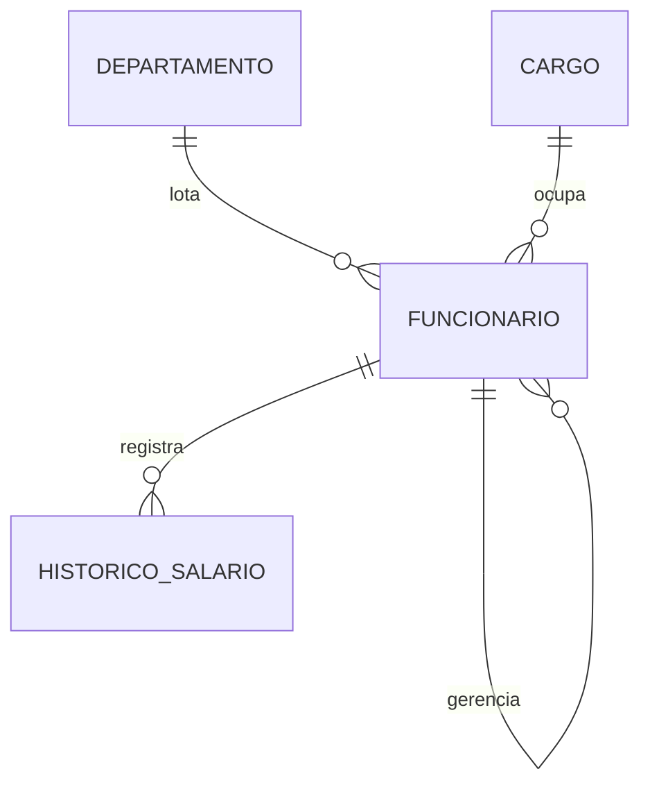

# Banco de Dados com Oracle — Recursos Humanos

Sistema de **Recursos Humanos** no **Oracle Database** com ênfase em **PL/SQL**: pacote com procedures e funções, cursores, exceções personalizadas, *trigger* de histórico salarial, consultas hierárquicas e funções analíticas.

> Material das disciplinas de Banco de Dados — Prof. Eduardo Furlanetti.

## Estudo de caso



Regras de negócio:

- O salário deve respeitar a **faixa do cargo**; a *trigger* rejeita valores fora dela com `ORA-20001`.
- Toda alteração salarial gera um registro em `HISTORICO_SALARIO`, com usuário e data.
- O reajuste por departamento é limitado a 30% e nunca ultrapassa o teto do cargo.
- A hierarquia de gestores (autorrelacionamento) permite montar o **organograma**.

## Recursos do Oracle explorados

| Recurso | Arquivo |
|---|---|
| `GENERATED AS IDENTITY`, `START WITH LIMIT VALUE`, restrições nomeadas | `01_schema.sql`, `03_dados.sql` |
| *Package* (especificação e corpo), `%TYPE`, `RETURNING INTO`, exceções | `02_plsql.sql` |
| Cursor `FOR UPDATE` com `WHERE CURRENT OF`, `RAISE_APPLICATION_ERROR` | `02_plsql.sql` |
| `CONNECT BY`, `SYS_CONNECT_BY_PATH`, `CONNECT_BY_ISLEAF` | `04_consultas.sql` |
| Funções analíticas, `FETCH FIRST`, `PIVOT`, `LISTAGG` | `04_consultas.sql`, `exercicios/` |

## Como executar

### Docker (Oracle Database Free)

```bash
docker compose up -d
docker logs -f rh-oracle        # aguarde "DATABASE IS READY TO USE!"
```

Execute os scripts com o usuário `rh`:

```bash
for f in 01_schema 02_plsql 03_dados 04_consultas; do
  docker exec -i rh-oracle sqlplus -s rh/rh@//localhost/FREEPDB1 @/scripts/$f.sql
done
```

### SQL Developer, DBeaver ou VS Code (Oracle SQL Developer Extension)

Conecte em `localhost:1521`, serviço `FREEPDB1`, usuário `rh`, senha `rh`, e execute os scripts na ordem como *script* (F5 no SQL Developer).

## Estrutura

```
scripts/
├── 01_schema.sql      # tabelas e restrições
├── 02_plsql.sql       # trigger e pacote PKG_RH
├── 03_dados.sql       # dados de exemplo e chamadas ao pacote
└── 04_consultas.sql   # consultas hierárquicas e analíticas
exercicios/
├── lista.md
└── solucoes.sql
```

## Licença

[MIT](LICENSE)
